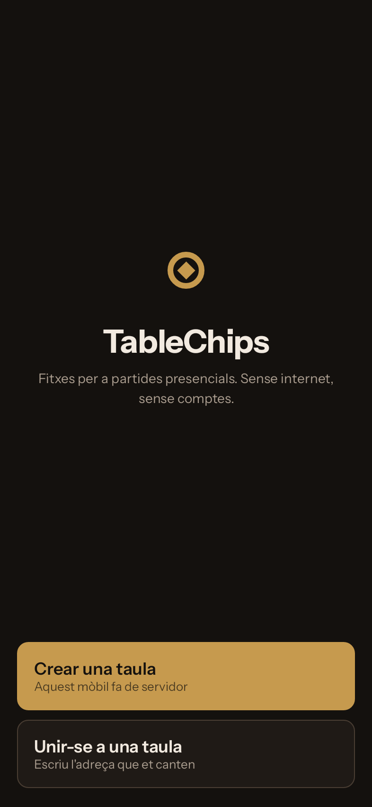
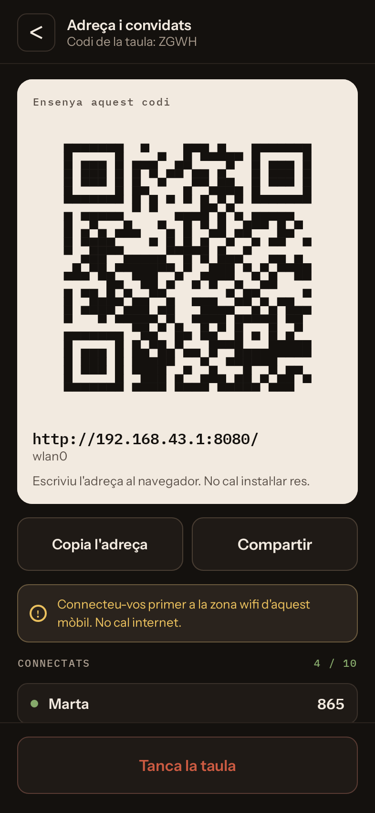
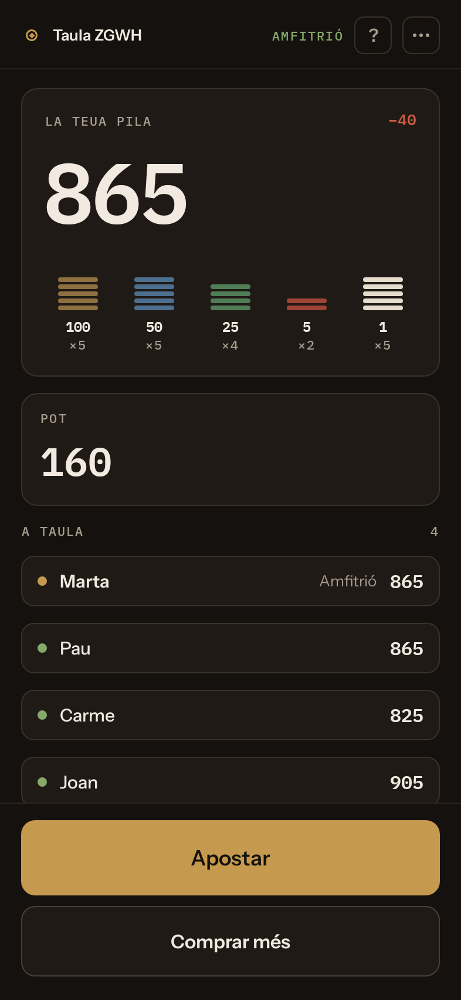
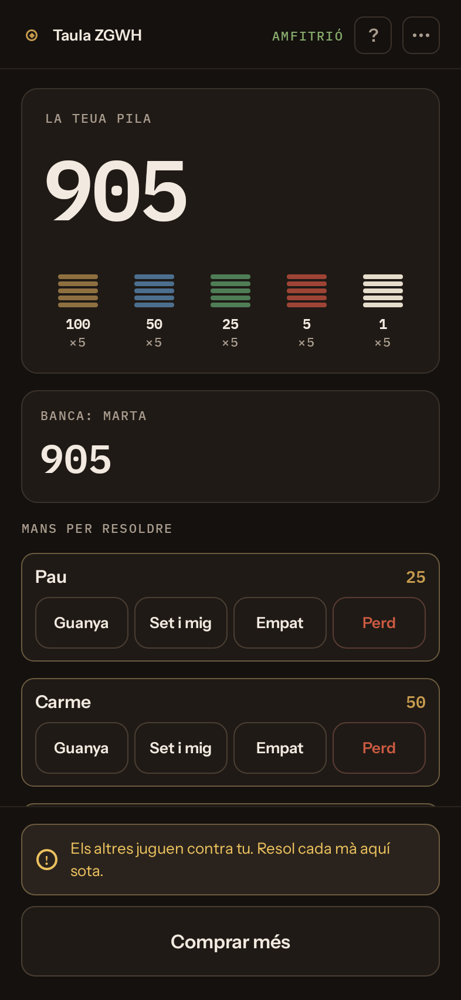

# TableChips

Fitxes per a una partida de cartes, sense fitxes. Un mòbil obri la taula i la
resta s'hi connecten des del seu, **sense internet, sense comptes i sense que
els convidats hagen d'instal·lar res**.

*[Read it in English](README.md) · [Léelo en castellano](README.es.md)*

  
  
  
  

Jugueu amb una baralla de veritat, com sempre. TableChips porta les fitxes: qui
en té quantes, què hi ha al pot i qui se l'endú. No reparteix cartes mai.

## Com es juga

1. **L'amfitrió** instal·la TableChips, activa la zona wifi del mòbil, toca
   **Crear una taula**, escriu el seu nom i l'obri.
2. **La resta** es connecten a aquesta zona wifi i escanegen el codi de la
   pantalla de l'amfitrió. La taula s'obri al navegador: igual val un iPhone
   que un Android. Qui tinga l'app també hi pot entrar des d'ella.
3. **Barregeu, repartiu i jugueu.** Les apostes, els pots i els pagaments van
   pels mòbils.

## Jocs

- **Set i mig** i **blackjack**, amb una banca contra la qual juga tothom.
- **Pòquer**, amb botó que es mou, cegues, l'import per igualar i pots
  laterals.
- **Mode manual** per a qualsevol altre joc (canari, muntet, truc…): pots,
  apostes i pagaments a mà.

## Per què TableChips

- **Els convidats no instal·len res.** N'hi ha prou amb el navegador.
- **Gens d'internet.** Funciona en un refugi de muntanya o en un poble sense
  cobertura.
- **Fins a deu jugadors**, cadascú amb el seu mòbil.
- **Desfer sense límit** i registre de cada moviment. Sempre es pot escriure
  l'import.
- **Feta per a una nit llarga:** els mòbils es reconnecten, els seients es
  guarden i la taula sobreviu a l'app de l'amfitrió tancada.
- **Català, castellà i anglès.**
- **Programari lliure.** Sense anuncis, sense compres integrades, sense
  comptes, sense rastreig.

TableChips compta fitxes. No hi ha diners, ni pagaments, ni comptes: el que
valga una fitxa ho decideix la gent de la taula.

## Requisits

L'amfitrió necessita un mòbil Android 8.0 o posterior que puga compartir la
zona wifi. Els convidats només necessiten un navegador.

## Desenvolupament

Com es compila, l'arquitectura i com es publiquen les versions són a
[docs/development.md](docs/development.md) (en anglès).

## Llicència

GPLv3. Vegeu [LICENSE](LICENSE). Els recursos de tercers i les seues llicències
són a [NOTICE](NOTICE).
