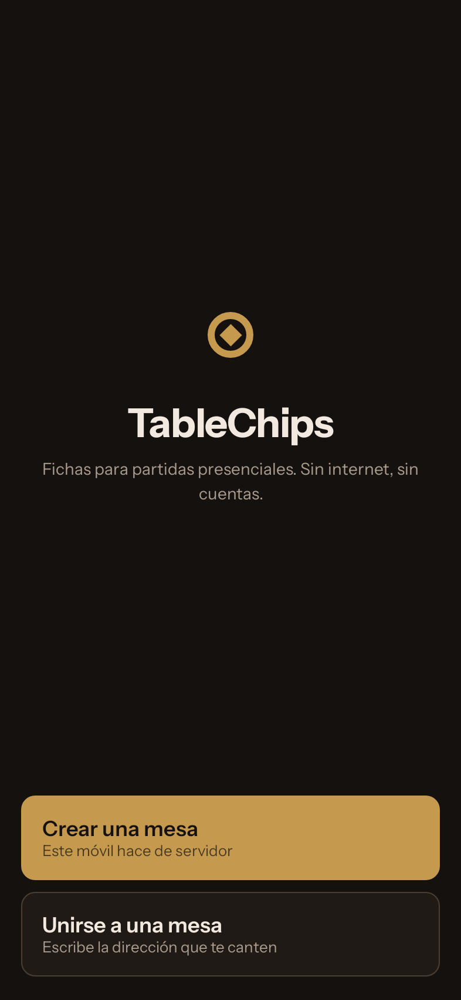
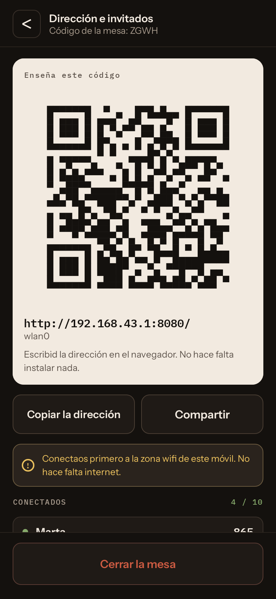
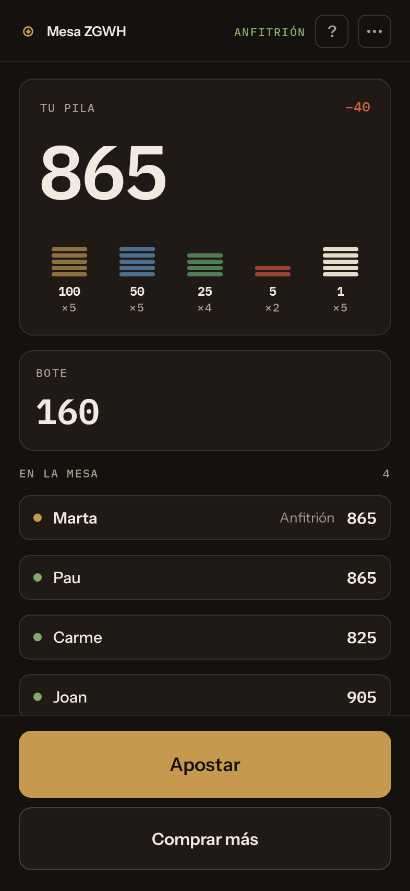
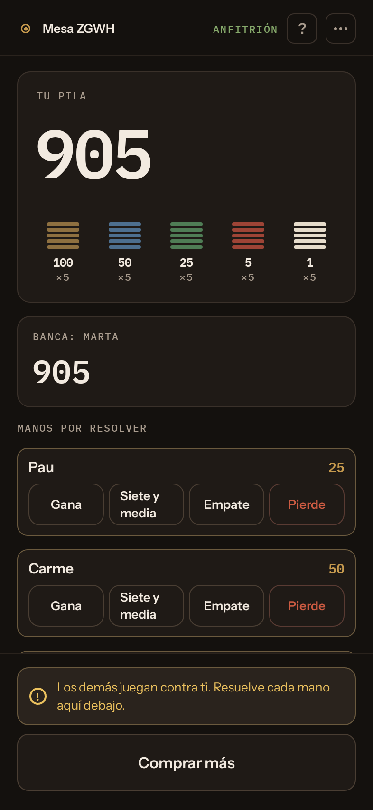

# TableChips

Fichas para una partida de cartas, sin fichas. Un móvil abre la mesa y el resto
se conectan desde el suyo, **sin internet, sin cuentas y sin que los invitados
tengan que instalar nada**.

*[Read it in English](README.md) · [Llegiu-ho en català](README.ca.md)*

  
  
  
  

Jugad con una baraja de verdad, como siempre. TableChips lleva las fichas:
quién tiene cuántas, qué hay en el bote y quién se lo lleva. Nunca reparte
cartas.

## Cómo se juega

1. **El anfitrión** instala TableChips, activa la zona wifi del móvil, toca
   **Crear una mesa**, escribe su nombre y la abre.
2. **El resto** se conectan a esa zona wifi y escanean el código de la
   pantalla del anfitrión. La mesa se abre en el navegador: vale igual un
   iPhone que un Android. Quien tenga la app también puede entrar desde ella.
3. **Barajad, repartid y jugad.** Las apuestas, los botes y los pagos van por
   los móviles.

## Juegos

- **Siete y media** y **blackjack**, con una banca contra la que juega todo el
  mundo.
- **Póquer**, con botón que se mueve, ciegas, el importe para igualar y botes
  laterales.
- **Modo manual** para cualquier otro juego (julepe, monte, truc…): botes,
  apuestas y pagos a mano.

## Por qué TableChips

- **Los invitados no instalan nada.** Basta con el navegador.
- **Nada de internet.** Funciona en un refugio de montaña o en un pueblo sin
  cobertura.
- **Hasta diez jugadores**, cada uno con su móvil.
- **Deshacer sin límite** y registro de cada movimiento. Siempre se puede
  escribir el importe.
- **Hecha para una noche larga:** los móviles se reconectan, los puestos se
  guardan y la mesa sobrevive a que se cierre la app del anfitrión.
- **Catalán, castellano e inglés.**
- **Software libre.** Sin anuncios, sin compras integradas, sin cuentas, sin
  rastreo.

TableChips cuenta fichas. No hay dinero, ni pagos, ni cuentas: lo que valga una
ficha lo decide la gente de la mesa.

## Requisitos

El anfitrión necesita un móvil Android 8.0 o posterior que pueda compartir la
zona wifi. Los invitados solo necesitan un navegador.

## Desarrollo

Cómo se compila, la arquitectura y cómo se publican las versiones están en
[docs/development.md](docs/development.md) (en inglés).

## Licencia

GPLv3. Véase [LICENSE](LICENSE). Los recursos de terceros y sus licencias están
en [NOTICE](NOTICE).
