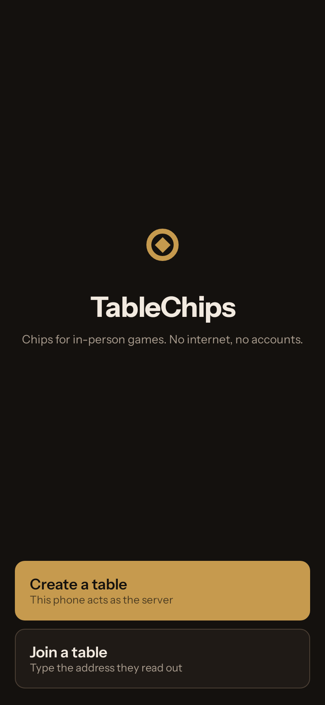
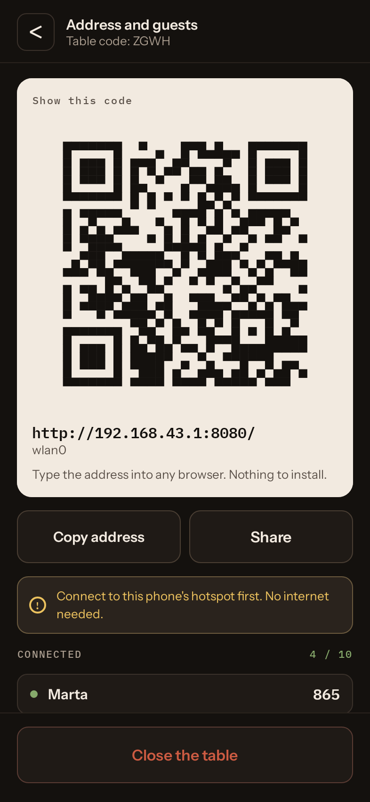
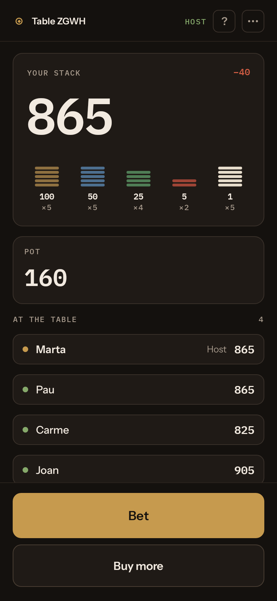
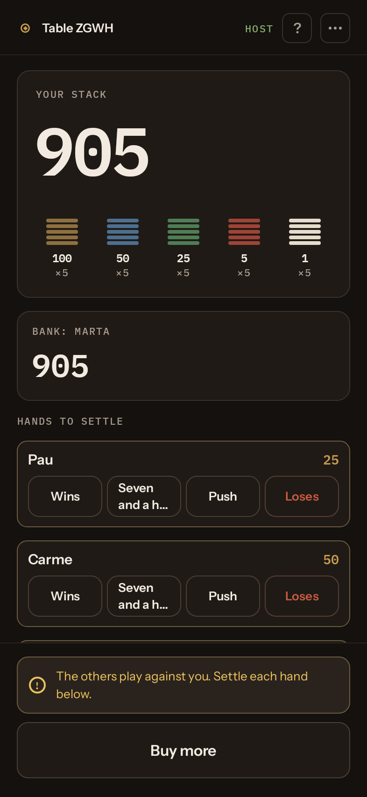

# TableChips

Chips for a card game, without the chips. One phone opens the table and everyone
else joins from their own phone, **with no internet, no account, and nothing for
the guests to install**.

*[Llegiu-ho en català](README.ca.md) · [Léelo en castellano](README.es.md)*

  
  
  
  

You play with a real deck, as always. TableChips keeps the chips: who has how
many, what is in the pot, who wins it. It never deals cards.

## How to play

1. **The host** installs TableChips, turns on the phone's hotspot, taps
   **Create a table**, types a name and opens it.
2. **The others** connect to that hotspot and scan the code on the host's
   screen. The table opens in the browser: an iPhone works as well as an
   Android. Whoever has the app can join from it too.
3. **Shuffle, deal and play.** Bets, pots and payouts go through the phones.

## Games

- **Seven and a half** and **blackjack**, with a bank that everybody plays
  against.
- **Poker**, with a moving button, blinds, the amount to call and side pots.
- **Manual mode** for any other game: pots, bets and payouts by hand.

## Why TableChips

- **Guests install nothing.** A browser is enough.
- **No internet at all.** It works in a mountain hut or a village with no
  signal.
- **Up to ten players**, each on their own phone.
- **Unlimited undo** and a log of every move. You can always type the amount.
- **Made for a long night:** phones reconnect, seats are kept, and the table
  survives the host's app being closed.
- **Catalan, Spanish and English.**
- **Free software.** No ads, no in-app purchases, no accounts, no tracking.

TableChips counts chips. There is no money, no payments, no accounts: what a
chip is worth is up to the people at the table.

## Requirements

The host needs an Android phone, Android 8.0 or newer, that can share a hotspot.
Guests only need a browser.

## Development

How it is built, the architecture and how releases are cut are in
[docs/development.md](docs/development.md).

## Licence

GPLv3. See [LICENSE](LICENSE). Third-party assets and their licences are listed
in [NOTICE](NOTICE).
